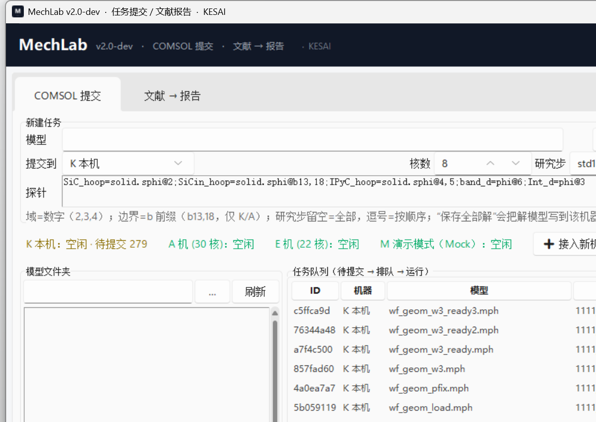

# MechLab

**面向计算力学的桌面对话式工作台：COMSOL 批处理提交 + 文献 → 仿真报告。**

MechLab 把两类重复劳动自动化：

1. **COMSOL 批量提交**：把模型、探针表达式、研究步丢进队列，自动在本机或远程 Windows 机器上跑 COMSOL、取回 CSV、看日志；内置 Mock 演示模式，没装 COMSOL 也能完整体验流程。
2. **文献 → 报告**：导入 PDF → 转 Markdown → DeepSeek 网页自动抽取结构化信息 → 生成「理论报告 + COMSOL 实现报告」（Markdown，可插原文图，可直接放进 Obsidian）。

> Windows 桌面程序（Python + tkinter），当前版本 `v2.0-dev`。

---

## 功能

### COMSOL 提交模块

- **多机器队列**：每台机器一条队列、互不阻塞；任务表显示状态/进度/用时；可中止、移除、清空。
- **探针表达式**：`label=expr@domain`（域）或 `@b13,18`（边界），支持多探针、批量模型。
- **远程提交**：SSH + `scp` 到 Windows 远程机，零残留/只写指定目录/审计日志；支持保存全部解到非 C 盘。
- **接入新机向导**：生成 PowerShell 采集脚本 → 粘贴输出自动识别 → 自动填表 → 测试连接 → 保存。
- **SSH 启动脚本**：目标机没开 OpenSSH 时，生成管理员脚本（安装/启动/放行端口/写公钥）。
- **Mock 演示模式**：低碳钢单轴拉伸，约 15 秒生成应力-应变 CSV / 曲线图 / 摘要，适合演示与验收。
- **一键画图**：只针对演示数据，窗口内直接画应力-应变与载荷-位移。

### 文献 → 报告模块

- **PDF → Markdown**：内置 PyMuPDF4LLM（快）；可选 MinerU（公式/表格更强，需本机安装）。
- **结构化抽取**：控制方程、弱形式、本构、参数表、边界条件、网格、求解器、验证图、缺失信息（JSON，带来源）。
- **两份报告**：理论报告（推导链/本构/弱形式/量纲/验证）与 COMSOL 实现报告（节点路径/BC/网格/求解器/逐步建模/Java 骨架）。
- **插图**：按 `[[FIG:n]]` 占位符把原文图插进报告（MinerU 精确图号映射；PyMuPDF 近似），导出时连 `assets/` 一起复制。
- **零 API Key**：通过浏览器自动化操作 DeepSeek 网页版（Playwright + 专用 Chrome profile，登录一次后复用）；不需要付费 API。

---

## 截图



---

## 快速开始

### 方式一：Windows 安装包（推荐给使用者）

下载 `MechLab-Setup-2.0-dev.exe`（Release 或构建产物），双击安装：

- 安装到 `%LOCALAPPDATA%\Programs\MechLab`，无需管理员权限；
- 自动创建桌面 / 开始菜单快捷方式并启动；
- 卸载：删除安装目录和快捷方式即可。

### 方式二：源码运行（推荐给开发者）

```bash
git clone https://github.com/<your-name>/MechLab.git
cd MechLab
python -m pip install -r requirements.txt
python run_gui.pyw
```

要求 **Python 3.11+**；Windows 下也可双击 `scripts/启动MechLab.bat`。

首次使用文献模块时，程序会弹出 Chrome 窗口让你登录一次 DeepSeek（登录态保存在 `.browser/`，已 gitignore）。

---

## 目录结构

```
MechLab/
├─ app/
│  ├─ shell.py                 # 主壳：标题栏 + 模块标签页
│  ├─ config.py                # 机器定义、路径、常量
│  ├─ backends.py              # K/A/E/M 提交命令构建
│  ├─ manager.py / runner.py   # 队列、并发、日志流
│  ├─ machine_probe.py / machine_ui.py   # 新机接入向导
│  ├─ demo_plot.py             # 演示模式一键画图
│  ├─ theme.py / assets/       # 主题与图标
│  └─ modules/
│     ├─ submitter/            # 模块①：COMSOL 提交
│     └─ papers/               # 模块②：文献→报告
│        ├─ pdf2md/            #   PDF→Markdown（pymupdf4llm / mineru）
│        ├─ web.py             #   DeepSeek 网页自动化
│        ├─ report.py          #   抽取 → 理论报告 → 实现报告
│        └─ prompts/           #   提示词模板
├─ engine/                     # COMSOL 引擎脚本（本机/远程/Mock）+ 演示数据
├─ installer/                  # 安装器（PyInstaller 打包）
├─ scripts/                    # 启动、构建、MinerU 安装、演示数据生成
├─ tests/                      # 自测与示例
├─ docs/                       # 使用说明、设计文档、截图
├─ requirements.txt
└─ run_gui.pyw
```

---

## 配置

### 远程机器（A/E 机或自建）

界面里的「远程 A（示例）」「远程 E（示例）」只是示例槽位，**不会连接任何机器**；需要用你自己的主机：
- 方式一：复制模板并填写（真实文件已被 `.gitignore` 排除）：

```bash
cp engine/remote/env_oldA.example.sh engine/remote/env_oldA.sh
cp engine/remote/env_evior.example.sh engine/remote/env_evior.sh
# 编辑 RG_HOST / RG_KEY / RG_PORT / RG_BASE_WIN / RG_BATCH / RG_COMPILE
```

- 方式二：完全不用示例槽位，直接在界面点「＋ 接入新机」，填写自己的机器信息（保存到本机 `machines.json`）。

要求目标机：Windows + OpenSSH Server + COMSOL（批处理可用）+ 可写目录 + 密钥登录。

### 本机 COMSOL（K 机）

默认引擎脚本 `engine/local_extract.sh` 按本机 COMSOL 安装路径调用；可通过环境变量 `COMSOL_BATCH` 覆盖 `comsolbatch.exe` 路径。

### 可选：MinerU 高质量 PDF 解析

```powershell
# Windows
powershell -ExecutionPolicy Bypass -File scripts/setup_mineru.ps1
```

装到独立 venv（`.venvs/mineru`）并下载模型（约 3.5 GB）；程序会自动检测。

### DeepSeek 网页自动化

- 需要本机安装 **Chrome**（程序用专用 profile 启动，不影响日常浏览器）；
- 首次会弹窗登录，登录态持久化；若失效会自动等待重新登录；
- 只发送单个请求、带随机延迟，失败可退回手动模式。

---

## 打包（Windows）

```bash
pip install pyinstaller
# 1) 应用（onedir）
python -m PyInstaller --noconfirm --clean --windowed --name MechLab \
  --icon app/assets/mechlab.ico \
  --add-data "app/modules/papers/prompts;app/modules/papers/prompts" \
  --add-data "app/assets;app/assets" \
  --collect-all sv_ttk --collect-all pymupdf4llm --collect-all pymupdf --collect-all playwright \
  --hidden-import matplotlib --hidden-import matplotlib.backends.backend_tkagg \
  --exclude-module torch --exclude-module transformers --exclude-module cv2 \
  run_gui.pyw
# 2) 安装包 + 便携 zip
python scripts/build_installer.py
```

产物：`dist/MechLab-Setup-2.0-dev.exe`、`dist/MechLab-Portable-2.0-dev.zip`。

---

## 已知限制

- **Windows 优先**：远程提交、新机向导、安装包均为 Windows 逻辑；macOS 需少量适配（`os.startfile`、`creationflags`、字体、.app 打包），详见 `docs/`。
- **无人值守的网页自动化**受 DeepSeek 页面改版/风控影响，程序已做失败降级，但不保证永久可用。
- 报告由 LLM 生成，**结论需人工复核**；插图位置由模型根据图注判断，可能不完美。
- 安装包未签名，SmartScreen 可能提示"未知发布者"。

---

## 许可

- 本项目代码：**MIT**（见 [LICENSE](LICENSE)）。
- 第三方依赖许可见 [THIRD_PARTY_NOTICES.md](THIRD_PARTY_NOTICES.md)。注意：**PyMuPDF / PyMuPDF4LLM 与 MinerU 为 AGPL-3.0**，分发包含它们的二进制安装包时需遵守 AGPL（本仓库即对应源码）。
- 本项目与 Ansys / COMSOL / DeepSeek 无隶属关系；相关名称仅用于说明兼容性。
- 使用本工具提交到他人的机器/集群前，请确认你有权限；远程脚本会做零残留与审计，但使用者需自行负责。

## 贡献

欢迎 Issue / PR。提交前请确保：不包含真实主机地址、私钥、API Key、个人路径；改动集中在 `app/`、`engine/`、`docs/` 内。
